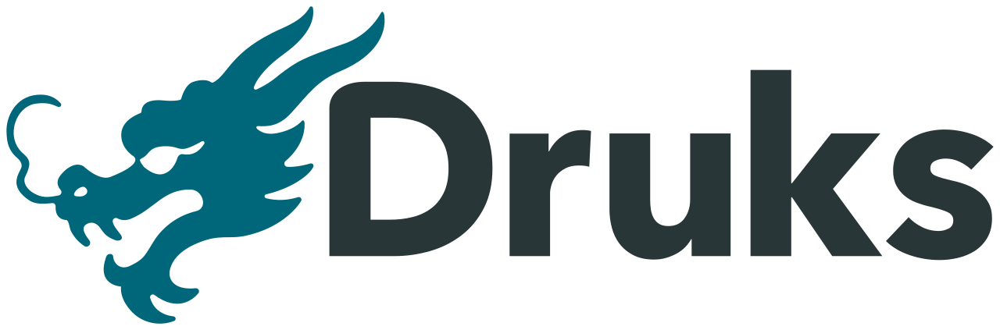
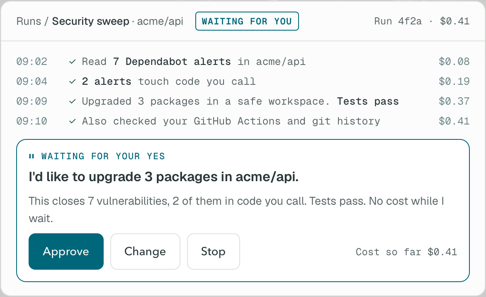
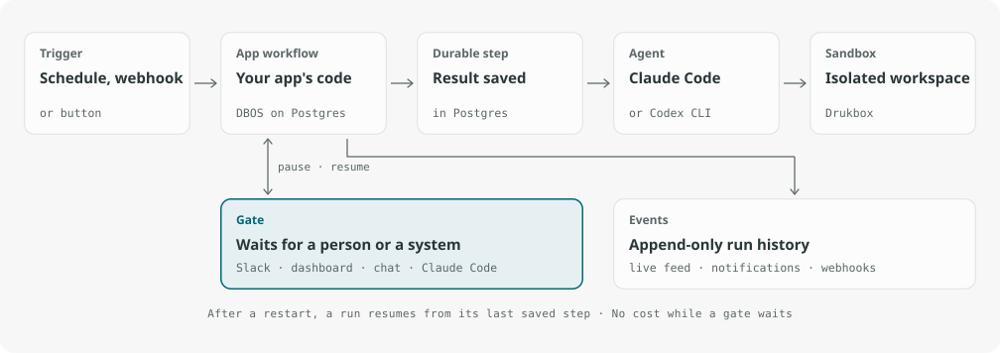

<p align="center">
  <picture>
    <source media="(prefers-color-scheme: dark)" srcset="docs/assets/logo/web/DruksLockup_Dark.svg">
    
  </picture>
</p>

<h3 align="center">AI agents work. You make the call.</h3>

<p align="center">
  Druks finds the work, does it on the tools you already use,<br>
  and brings the important decisions to you. Self-hosted or Druks Cloud.
</p>

<p align="center">
  <a href="https://app.druks.ai/sign-in?utm_source=github&utm_medium=readme"><b>Try it now</b></a> ·
  <a href="#get-started"><b>Install on your AI</b></a> ·
  <a href="https://docs.druks.ai/?utm_source=github&utm_medium=readme">Docs</a>
</p>

<p align="center">
  <a href="LICENSE"></a>
  
  
  <a href="#contributors"></a>
</p>

<p align="center">
  
</p>

**Druks is a self-hosted or cloud platform where AI agents such as Claude Code and Codex do a company's recurring engineering work, and a person approves each change.**

- **It finds the work.** A schedule, an alert or a button starts it. Nobody writes a prompt.
- **It does the work with your tools.** Claude Code or Codex, with your own Claude or OpenAI account, in a sandbox, on your real repositories. You see the cost after every step.
- **You make the call.** The run stops and asks you: Approve, Change or Stop. You answer in Slack, the dashboard, the Druks chat or Claude Code. It waits up to 14 days and costs nothing while it waits.

## Why Druks

| If you use… | It helps when… | Druks adds… |
| --- | --- | --- |
| A coding assistant (Claude Code, Codex, Copilot) | A developer sits down and asks | Work that starts by itself, every week, with nobody at the keyboard |
| An agent board | You write a ticket and assign it to an agent | Processes that find the work themselves, like a weekly security sweep |
| A workflow builder | You design each step of the flow | Apps that already work. Build your own only when you want to |

Druks does not replace your coding agent. It puts the agent on a schedule, runs it in a sandbox, and brings you its result as one decision.

## What a run looks like

<!-- Publish this section when the security sweep app ships. Until then, link to the Software Factory example in docs. -->

The **security sweep** checks one repository every Monday:

1. It reads the open Dependabot alerts and checks which ones touch code you actually call.
2. It upgrades the packages in a sandbox and runs your tests.
3. It asks you: *"Upgrade 3 packages. Closes 7 vulnerabilities, 2 in code you call. Approve?"* After your yes, it opens a pull request.
4. You get a summary: the pull request, what was fixed, how long it took and what it cost.

The included **Ticket to pull request** app (`software_factory`) takes a ticket, writes and checks the change, and opens a pull request for review.

## Get started

Druks Cloud and self-hosted Druks work the same way. You get the same apps and approve in the same places. The only difference is where Druks runs.

**Druks Cloud.** Druks runs on our servers. Nothing to install. [Try it now](https://app.druks.ai/sign-in?utm_source=github&utm_medium=readme).

**Self-hosted.** Druks runs on your laptop or your own server. You need Docker with Compose. Paste this into Claude Code, Codex or any coding agent on the machine:

```text
Install Druks on this machine with https://druks.ai/install.sh. Read the script, then run it. Then run the steps it prints: build the sandbox images and run druks doctor. If a step fails, stop. Show me the failed step and its output. Do not improvise a fix. When druks doctor passes, open http://127.0.0.1:8001 in my browser.
```

Or run the installer yourself:

```bash
curl -fsSL https://druks.ai/install.sh | bash
```

Then build the sandbox images, check the install and open the dashboard:

```bash
cd ~/druks
docker compose exec web druks sandboxes build
docker compose exec web druks doctor
open http://127.0.0.1:8001   # on Linux: xdg-open
```

In the dashboard, connect your AI account under **Settings → Providers** and the GitHub App under **Settings → Connections → Services**.

<details>
<summary>Remote installs (exe.dev and other providers)</summary>

Name the provider. The installer lists the values only you know, then exits. Set them in `~/druks/druks.toml` and `~/druks/.env`, and run the same command again.

```bash
curl -fsSL https://druks.ai/install.sh | DRUKS_PROVIDER=exe bash
```

The [deployment guide](https://docs.druks.ai/deployment) covers access control, upgrades and rollback.
</details>

## What runs where

When you self-host, this is what happens with your code and your keys:

- **Druks runs on your machine.** The dashboard, Postgres, Redis and the sandbox service run in Docker on your host.
- **By default, each agent call runs in its own Drukbox sandbox,** with the tools and credentials of that step.
- **Your code goes to the AI provider you choose,** through your own Claude or OpenAI account, and back to GitHub as pull requests.
- **Connection secrets are encrypted** in your own database.
- **GitHub access goes through your own GitHub App,** on the repositories you pick.
- **No telemetry.** Druks does not send usage data to us.
- **Apps ask before they act.** The security sweep opens a pull request only after your yes. Every proposal, decision and cost stays in the run history.

Found a security problem? Follow the [security policy](SECURITY.md). Do not open a public issue.

## How it works

<p align="center">
  
</p>

Each process is an **app**. After a restart or deploy, Druks picks up where it left off and does not repeat finished work. [Concepts and guarantees](https://docs.druks.ai/concepts) explains the details.

## Documentation

| I want to… | Start here |
| --- | --- |
| Install Druks on my machine | [Quickstart](https://docs.druks.ai/quickstart) |
| Run Druks for my team | [Deployment](https://docs.druks.ai/deployment) and [configuration](https://docs.druks.ai/configuration) |
| Automate my own process | [Writing an app](https://docs.druks.ai/writing-an-app), then `uvx --from druks druks create app my-app` |
| Understand restarts and approvals | [Concepts](https://docs.druks.ai/concepts) |
| Fix a problem | [Troubleshooting](https://docs.druks.ai/troubleshooting) |

## Status

Druks is **pre-1.0**. Breaking changes can happen. `main` and `latest` are edge builds, not stable releases. Run the installer again to upgrade. For a fixed version, see [installing an immutable version](https://docs.druks.ai/releasing#install-an-immutable-version).

## Community

- **Bugs, questions and ideas:** [open an issue](https://github.com/czpython/druks/issues)
- **Contributing:** [contribution guide](CONTRIBUTING.md)

## License

Druks is available under the [Functional Source License](LICENSE) (FSL-1.1-ALv2):

- You can read, run and change all of the code.
- You can self-host Druks for your company's work and build apps on it.
- You cannot sell it as a competing hosted service.
- Each release becomes Apache 2.0 two years after it ships.

The [licensing page](https://docs.druks.ai/licensing) explains the details.

## Contributors

Thanks goes to these wonderful people:

<!-- ALL-CONTRIBUTORS-LIST:START - Do not remove or modify this section -->
<!-- prettier-ignore-start -->
<!-- markdownlint-disable -->
<table>
  <tbody>
    <tr>
      <td align="center" valign="top" width="14.28%"><a href="https://github.com/czpython"><br /><sub><b>Paulo Alvarado</b></sub></a><br /><a href="https://github.com/czpython/druks/commits?author=czpython" title="Code">💻</a></td>
      <td align="center" valign="top" width="14.28%"><a href="https://github.com/chaosk"><br /><sub><b>Krzysztof Socha</b></sub></a><br /><a href="https://github.com/czpython/druks/commits?author=chaosk" title="Code">💻</a></td>
      <td align="center" valign="top" width="14.28%"><a href="https://github.com/p-r-a-v-i-n"><br /><sub><b>Pravin</b></sub></a><br /><a href="https://github.com/czpython/druks/commits?author=p-r-a-v-i-n" title="Code">💻</a></td>
      <td align="center" valign="top" width="14.28%"><a href="https://github.com/dserbano"><br /><sub><b>Dan Serbanoiu</b></sub></a><br /><a href="https://github.com/czpython/druks/commits?author=dserbano" title="Code">💻</a></td>
      <td align="center" valign="top" width="14.28%"><a href="https://github.com/RCheesley"><br /><sub><b>Sīlavāpi Cheesley</b></sub></a><br /><a href="https://github.com/czpython/druks/commits?author=RCheesley" title="Code">💻</a></td>
      <td align="center" valign="top" width="14.28%"><a href="https://github.com/stefanfoulis"><br /><sub><b>Stefan Foulis</b></sub></a><br /><a href="https://github.com/czpython/druks/commits?author=stefanfoulis" title="Code">💻</a></td>
      <td align="center" valign="top" width="14.28%"><a href="https://github.com/yuripulga"><br /><sub><b>yuripulga</b></sub></a><br /><a href="https://github.com/czpython/druks/commits?author=yuripulga" title="Code">💻</a></td>
    </tr>
    <tr>
      <td align="center" valign="top" width="14.28%"><a href="https://github.com/kakshilshah"><br /><sub><b>Kakshil Shah</b></sub></a><br /><a href="https://github.com/czpython/druks/commits?author=kakshilshah" title="Code">💻</a></td>
      <td align="center" valign="top" width="14.28%"><a href="https://github.com/jasoneka"><br /><sub><b>Andrzej Jasonek</b></sub></a><br /><a href="https://github.com/czpython/druks/commits?author=jasoneka" title="Code">💻</a></td>
    </tr>
  </tbody>
</table>

<!-- markdownlint-restore -->
<!-- prettier-ignore-end -->

<!-- ALL-CONTRIBUTORS-LIST:END -->

This project follows the [all-contributors](https://github.com/all-contributors/all-contributors) specification. Contributions of any kind welcome!
